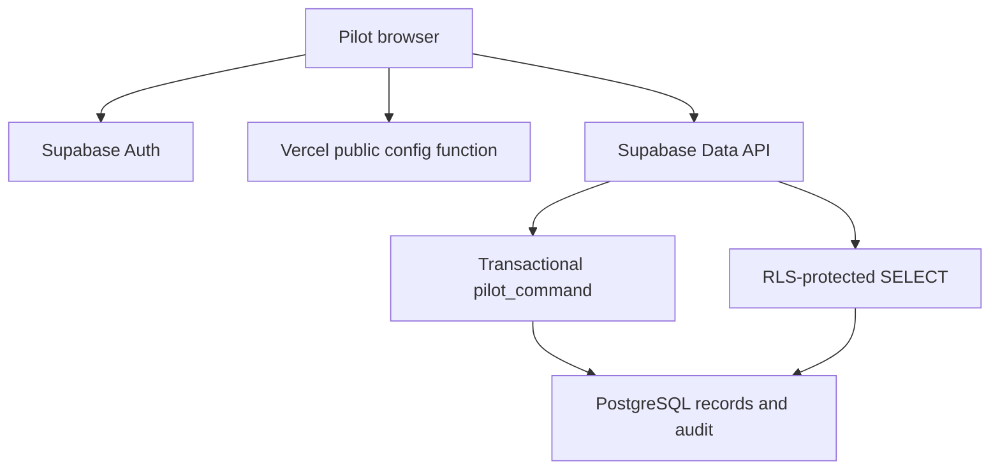

# LoanMatcha developer handoff

Status: backend foundation and connected-pilot UI implemented; hosted database/auth provisioning still pending. Do not treat this as an operational lending system.

## Where to start

- `/admin` and `/workspace`: original standalone, localStorage-based demos.
- `/pilot`: separate connected pilot; no localStorage loan records and no role-switch bypass.
- `supabase/migrations/001_pilot.sql`: database tables, RLS policies and transactional command API.
- `pilot.js`: authenticated Supabase REST client and pilot workflow screens.
- `api/pilot-config.js`: Vercel Function returning public config only; returns 503 until configured.
- `docs/SETUP.md`: provisioning, invited accounts and deployment instructions.
- `tests/pilot`: PostgreSQL-engine regression suite, isolated from application dependencies.

## Architecture



The database derives the actor from `auth.uid()` and resolves an active membership. Client role checks only control presentation; the command API independently enforces roles, ownership and status transitions. No service-role key is required by the deployed app. Supabase password auth issues the bearer token. The browser keeps it only in memory; reload requires login. Automatic session refresh, MFA and password recovery UI are not implemented in this pilot.

## Database model

| Table | Purpose / relationships |
|---|---|
| lenders | Organization and pending/active/declined onboarding status |
| partners | Loan channeling organization |
| memberships | Auth user -> one admin/lender/partner role; organization scope; active flag |
| allocations | Lender, capital/ticket in integer centavos, borrower count, criteria, review/funding status |
| borrowers | Partner-owned synthetic account, profile, consent timestamp |
| applications | Borrower -> allocation and qualification/matching/decision status |
| disbursements | One simulated release per application; authoritative amount from allocation |
| payments | Sample payment, globally unique external reference, pending/reconciled/rejected |
| audit_records | Actor, action, entity, timestamp; client has read-only access |
| private.commands | Actor + request UUID, payload fingerprint and result for idempotency |

Use distinct synthetic account numbers. A unique partial index permits only one non-declined application per borrower. This pilot's create command creates a borrower and application together; reapplication UI is not implemented.

## Permissions

| Action | Admin | Lender | Partner |
|---|---|---|---|
| Activate pending lender | Yes | No | No |
| Submit allocation | No | Own active organization | No |
| Review / verify sample funding | Yes | No | No |
| Submit sample borrower + consent | No | No | Own active organization |
| Qualify / match / submit application | Yes | No | No |
| Approve / decline application | No | Own allocation, after submission | No |
| Simulate release | No | Own approved application | No |
| Record / reconcile sample payment | Yes | No | No |
| Read allocations | All | Own | No |
| Read borrower profiles | All | No | Own |
| Read applications | All | Own allocation after admin submission | Own borrowers |
| Read audit | All | No | No |
| Grant roles | Out-of-band owner setup | No | No |

The lender currently sees application IDs/status, not borrower PII. A sanitized, versioned borrower-package model and document permissions are still to build. The partner receives application/disbursement/payment statuses for its own borrowers. Confirm that visibility before expanding the pilot.

## API contract

`GET /api/pilot-config` returns public Supabase URL + publishable/anon key, or HTTP 503 while provisioning is pending. Secret and service-role keys are rejected.

`POST <SUPABASE_URL>/auth/v1/token?grant_type=password` signs in an invited pilot account. Tokens come from Supabase, not custom password storage.

Authenticated reads: `GET /rest/v1/<table>?select=*`. All listed tables have RLS and client SELECT grants only.

Writes: `POST /rest/v1/rpc/pilot_command` with `apikey`, `Authorization: Bearer <access_token>` and JSON:

```json
{
  "p_action": "create_allocation",
  "p_entity_id": null,
  "p_payload": {"title":"Demo allocation","capital_centavos":10000000,"borrower_count":2,"terms":{"criteria":"Synthetic pilot"}},
  "p_request_id": "A_NEW_UUID"
}
```

Response: `{ "id": "entity UUID", "action": "command name" }`. Retry the exact same payload with the same request UUID after ambiguous network failure; a changed payload with a reused ID is rejected. Validation/permission failures roll back all records including audit/idempotency. Use a new UUID for a new action.

| Command | Required payload |
|---|---|
| create_allocation | title, capital_centavos, borrower_count; optional terms object |
| activate_lender / decline_lender | entity = pending lender |
| approve_allocation | entity = submitted allocation |
| request_changes / decline_allocation | note |
| resubmit_allocation | note; entity must be changes_requested |
| verify_funding | reference; entity must be approved |
| create_application | account_number, consent=true; optional synthetic profile |
| qualify_application | entity = submitted application; optional note |
| match_application | allocation_id; application qualified, allocation funding_verified |
| submit_application | entity = candidate application |
| approve_application / decline_application | entity = with_lender application; decline requires note |
| simulate_release | entity = approved application |
| record_payment | entity = released application; amount_centavos, reference |
| reconcile_payment / reject_payment | entity = pending payment |

## Workflow and balances

Allocation: submitted -> approved -> funding_verified. A submitted allocation may become changes_requested -> submitted or declined. Declined allocations cannot be reopened by pilot commands.

Application: submitted -> qualified -> candidate -> with_lender -> approved -> released. The lender can decline at with_lender. Declines free the matching slot. Existing candidates stay invisible to the lender until submitted.

Funding is a sample-reference check; it does not confirm money in a bank account. Currency is PHP. Capital must split into whole centavos across borrower count. Capacity counts candidate + with_lender + approved + released. Approval reserves ticket amount; release converts the reservation into simulated released amount. Allocation row locks serialize matching/approval/release checks; application row locks stop duplicate state changes. A unique disbursement/application constraint provides a second duplicate-release guard. Idempotency is additionally serialized per actor/request UUID.

Available = verified capital - approved reservations - simulated releases. Pending candidates/packages consume slots but do not reserve capital. Partner actions cannot choose another partner tenant; lender actions cannot choose another lender tenant.

Payment: pending -> reconciled or rejected. Sample reconciliation records a status only: no automatic amortization, interest/principal allocation, ledger postings or closure is performed.

## Build scope

| Implemented code | Not yet connected | Not yet built |
|---|---|---|
| Original demo screens + local persistence | Supabase project, migrations, auth accounts | Actual file uploads and signed document access |
| Pilot login + membership-scoped views | Vercel public config env vars | Production onboarding verification integration |
| SQL command API + row-level policies | Live login/API/database end-to-end test | Underwriting integrations and package snapshots |
| Capacity/reservation/release gates | Synthetic pilot organizations and accounts | Bank/payment provider integration |
| Sample payment reconciliation + audit | Live multi-account isolation verification | Webhooks, failed/unknown transfer states, reconciliation ledger |
| PostgreSQL-engine regression tests | Provider backups/retention settings | Repayment schedules, collections automation, notices, reporting |

All release actions in this implementation are explicitly simulated. Production transfer design must use an outbox and provider idempotency key: approved -> queued -> processing -> succeeded / failed / unknown. Keep reservations while processing/unknown; reconcile against provider status before retry or cancellation. Only a verified succeeded event should book a real release. This design is documented, not implemented.

## Acceptance before inviting pilot users

Run the committed database tests; apply migration to an empty dedicated Supabase pilot; disable public signups; create invited test users and memberships; verify admin, two different lenders and a partner; repeat the full flow from separate browsers; verify direct API calls cannot bypass role/tenant guards; inspect audit and duplicate request behavior. Keep all test data synthetic. No real payments or borrower documents in this pilot.

## Decisions to confirm before production

Who legally disburses and owns the receivable; acceptable borrower-package fields for lenders; maker/checker funding verification; authority to cancel approved applications; precise interest/fees/payment allocation; delinquency rules; retention and consent policy; bank provider and reconciliation process. Do not infer these from the sample prototype.
